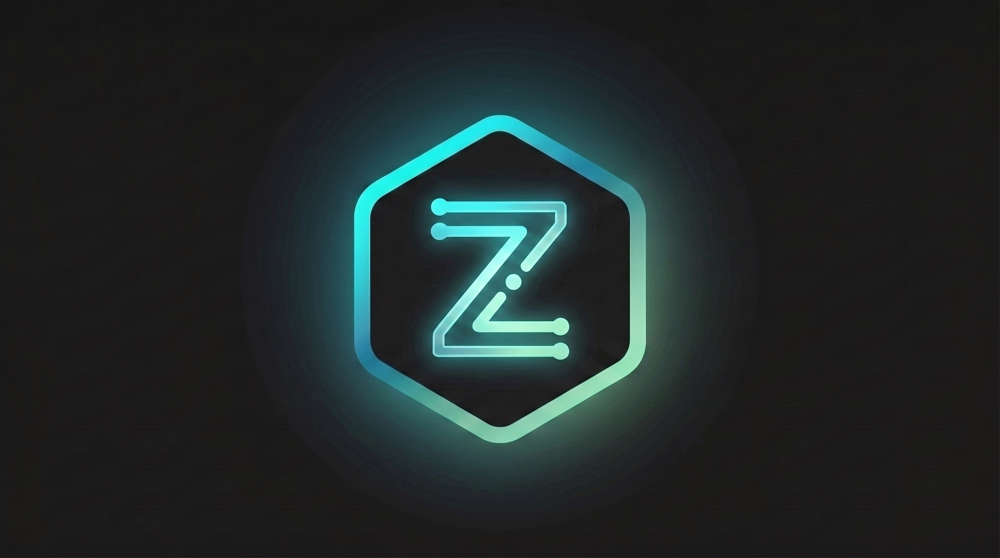

<div align="center">
  
</div>

# Zyne

A personal reading and focus app. One codebase, two deliberately different jobs:

| | Phone | Laptop |
|---|---|---|
| Purpose | consuming | working |
| Pages | Feed, Journal | Focus, Library, Journal |

**Phone:** a feed of ~60 curated sources ranked against your own interest profile, plus a bullet journal.
**Laptop:** a focus timer, a book-idea library, and the same journal. The news feed never appears on the machine you work on.

Built with Tauri 2, vanilla JS and SQLite. No accounts, no telemetry. Everything stays on your device by default.

---

## What it does

**Feed** *(phone)*: YouTube channels, subreddits, Hacker News, GitHub repos, Google News and any RSS feed, fetched in parallel and de-duplicated into a two-column card grid. Ranking runs locally by keyword against an interest profile you write in plain text. If you add an Anthropic API key, a batched Claude Haiku call ranks the cards instead and adds a one-line hook to each. Either way the batch is capped and ends with a "you're caught up" card, so there's no endless scroll.

**Focus** *(laptop; the timer appears on both)*: one `+` button. Type what you're doing and press Enter to start. When you stop, the session writes itself into today's journal. There are four rhythms, each with a note on what it suits: Pomodoro 25/5, 52/17, a 90/20 deep block, and Flowtime, which just counts up. Sounds are your own YouTube links, each with a role:

```
loop  <link> | Label            background; resumes on "+", repeats
break <link> | Label | minutes  guided; offered only if the break is long enough
night <link> | Label | minutes  once-a-night ritual; own card, done-for-today mark
```

**Daily draw**: one tarot card a day, face-down until you tap it. The card is written into that day's journal and turns face-down again at midnight. The deck text was written for this app.

**Library** *(laptop; a Books chip on the phone)*: a discovery feed with **one idea per card**. Ideas are extracted from book-summary feeds by pattern matching, with no AI. Save an idea and it becomes markdown. Save the book and it joins a reading list that resurfaces during your timer breaks. You never type book data.

**Journal**: a bullet journal per day. Timed events live in SQLite with reminders. Tasks and notes are markdown files using Obsidian's task syntax, including migrate (`- [>]`) and skip (`- [-]`).

## Your data

Everything in markdown lands in `Documents/ZyneVault/`, so you can point Obsidian at it:

```
journal/2026-08-17.md   daily log: tasks, notes, focus sessions, the day's card
reading-list.md         books you saved
ideas/                  idea cards you kept
clips/                  articles you clipped
```

Transient state (feed items, events, settings) lives in SQLite in the app's data directory.

## Running it

**Prerequisites:** Node 18+, pnpm, and Rust (via rustup). Building for Android also needs Android Studio, an NDK and the Rust Android targets. Section 3 of [`zyne-app/V1_SETUP.md`](zyne-app/V1_SETUP.md) walks through it; ignore the Ollama parts of that guide, which are obsolete.

The app lives in `zyne-app/`, so run commands from there:

```bash
cd zyne-app
pnpm install
pnpm tauri dev                                     # desktop app, live reload
pnpm dev                                           # browser-only UI dev
pnpm tauri build                                   # Windows installer
pnpm tauri android build --apk --target aarch64    # signed phone APK
```

Run the self-check from the repo root:

```bash
node zyne-app/src/js/focus-library.test.js
```

`pnpm dev` is the fast loop for UI work. Feed fetches go through a `/zx` Vite proxy, and the database and vault fall back to memory and localStorage. **Files only get written in the real Tauri app.** The browser can't reach `Documents/ZyneVault`.

Android signing is not in this repo. See [`zyne-app/README.md`](zyne-app/README.md#android-signing-after-a-fresh-clone) for how to set it up after a fresh clone.

## Folder structure

```
.
├── README.md                 you are here
├── CLAUDE.md                 design rules and gotchas; read before changing things
├── STATUS.md                 snapshot of where work last stopped
├── Logo/                     app logo
├── .claude/commands/         /catchup and /handoff session commands
└── zyne-app/                 the app
    ├── index.html            every page; nav gated by .mobile-only / .desktop-only
    ├── vite.config.ts        dev server + /zx fetch proxy
    ├── src/
    │   ├── js/
    │   │   ├── app.js                UI wiring for every page
    │   │   ├── feed.js               source DSL + fetchers (youtube/reddit/hn/github/gnews/rss/books)
    │   │   ├── ranker.js             local keyword scoring + optional Claude Haiku pass
    │   │   ├── books.js              book-summary articles → single-idea cards
    │   │   ├── library.js            reading list + saved ideas as markdown
    │   │   ├── focus.js              Pomodoro state machine, sound roles
    │   │   ├── tarot.js              78-card deck + lines to sit with
    │   │   ├── journal.js            bullet-journal markdown engine
    │   │   ├── schedule.js           date/recurrence helpers
    │   │   ├── db.js                 SQLite schema + CRUD, in-memory fallback
    │   │   ├── companion-*.js        sync groundwork (see below)
    │   │   └── focus-library.test.js runnable self-check
    │   ├── styles/           main.css (theme) · feed.css · focus.css · daylight.css
    │   └── assets/           icons and wordmarks
    └── src-tauri/            Rust shell
        ├── src/lib.rs        plugin setup (sql, http, fs, dialog, notification, opener)
        ├── src/companion.rs  LAN pairing listener + Gemini chat commands
        ├── capabilities/     Tauri permissions
        ├── tauri.conf.json   app config
        └── gen/              generated Android project; git-ignored, holds the signing key
```

## Sync groundwork (not wired up yet)

Each device currently has its own vault and settings. The companion layer is the start of syncing them. The Rust side is in place, but the front end doesn't import it yet, so none of it is reachable from the UI. Everything is **off unless turned on**:

- **LAN pairing:** a listener on the local network. Every request needs a 64-hex bearer token, checked in constant time. The client refuses addresses that aren't private, loopback or link-local, and the listener stops itself after 30 minutes.
- **Encrypted backup:** AES-GCM, with the key derived from your password by PBKDF2 at 250k iterations.
- **Gemini chat:** opt-in, with a key you import yourself. The key is stored in app data, never in the JS bundle or a sync payload. When this is enabled, it's the one place where Zyne sends data to a third party.

## Notes if you're reusing this

The app opens directly, with no app-wide PIN. Use your device lock for access control. Zyne doesn't encrypt the local vault files.

Focus sounds use YouTube's official IFrame embed at 280×200. [Their policy](https://developers.google.com/youtube/terms/required-minimum-functionality) forbids hiding the player or playing audio only, which is why there's no invisible background mode.

Book idea cards are the summariser's words about a book, not the book's own prose. Every card names its source and links to the full summary.

## License

MIT. See [LICENSE](LICENSE).
